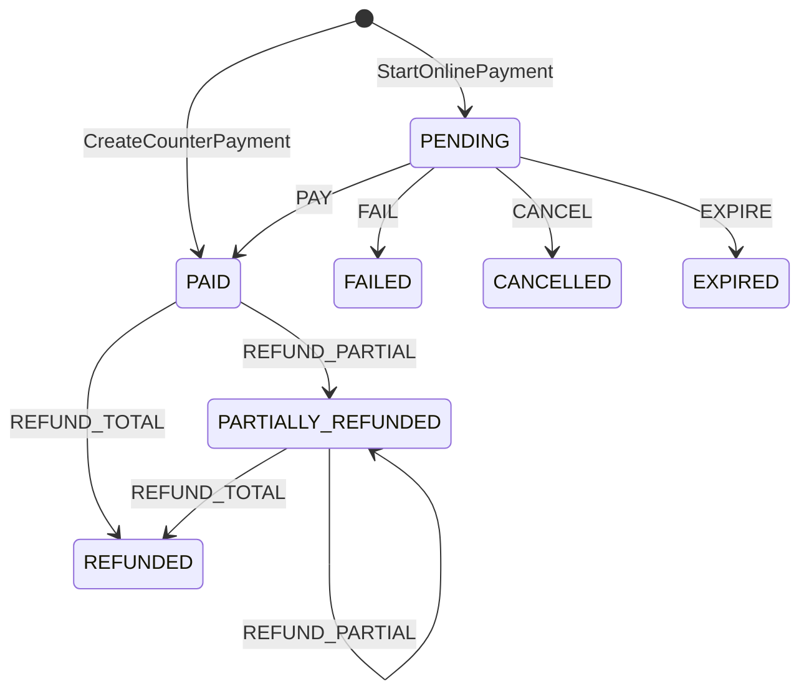

# Architecture - Payment Manager

Este módulo gestiona la persistencia, estados y conciliación de pagos.
Está diseñado para ser la fuente de la verdad financiera de pagos (mesón/online).

## Entidades Principales

- `Payment`: Registro de pago, con un id único, apuntando a una referencia (`ReferenceModule`/`ReferenceId`).
- `Refund`: Una devolución (reversa o anulación) efectuada sobre un `Payment`.

## Máquina de Estados (FSM)

## Flujo Online (Webpay)

1. **Cliente / App** llama a `start_online_payment`.
2. Servidor pide `Gateway.Start` (por ejemplo Transbank). Devuelve token y URL.
3. El frontend envía POST form `token_ws` a la URL (navegador abandona la App).
4. El proveedor redirige al retorno de Velty Labs (`CompleteOnlinePayment`).
5. Servidor verifica el estado con `Gateway.Commit(token)`.
6. Si hay discrepancia de montos, se emite un `Refund` inmediato hacia la pasarela, evitando cobros indebidos.

## Reglas Strictas de Dinero

- **Nunca de entrada de cliente**: El valor se consulta siempre al módulo dueño (e.g. `appointment_booking` vía `ChargeReader`).
- **Enteros y Monedas**: Siempre se almacena el monto en las unidades mínimas indivisibles (`int64`). CLP sin decimales, USD con 2.
- **Transaccionalidad en Reembolsos**: La actualización de montos de pagos y registros de devoluciones ocurre en transacción con versiones optimistas.
