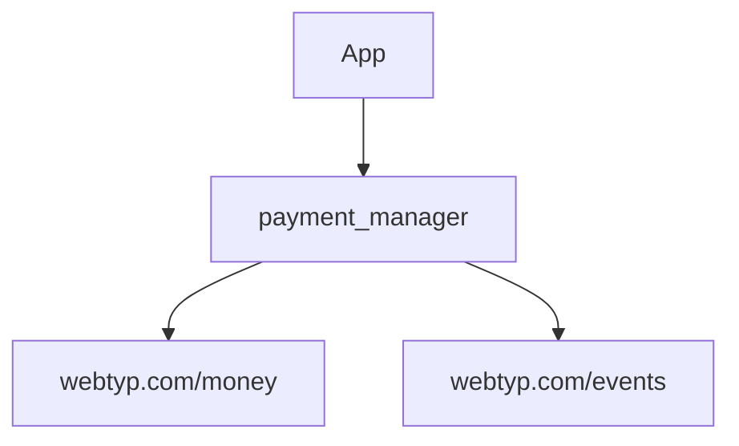

# Ubicación del módulo

Este diagrama muestra qué importa `payment_manager` y quién lo importa.

## Paso a paso

1. La **App** (aplicación principal) ensambla el sistema e importa este módulo.
2. `payment_manager` importa `webtyp.com/money` para publicar hechos económicos de pagos y devoluciones.
3. `payment_manager` importa `webtyp.com/events` para usar el publicador de eventos (`events.Publisher`).
