# Flujos de `payment_manager`

Cada rombo lleva un id (`C1`, `S2`, …). Cada rama tiene una prueba en `tests/` con su id en el nombre o en un comentario.

## 1. Estados del pago (FSM)

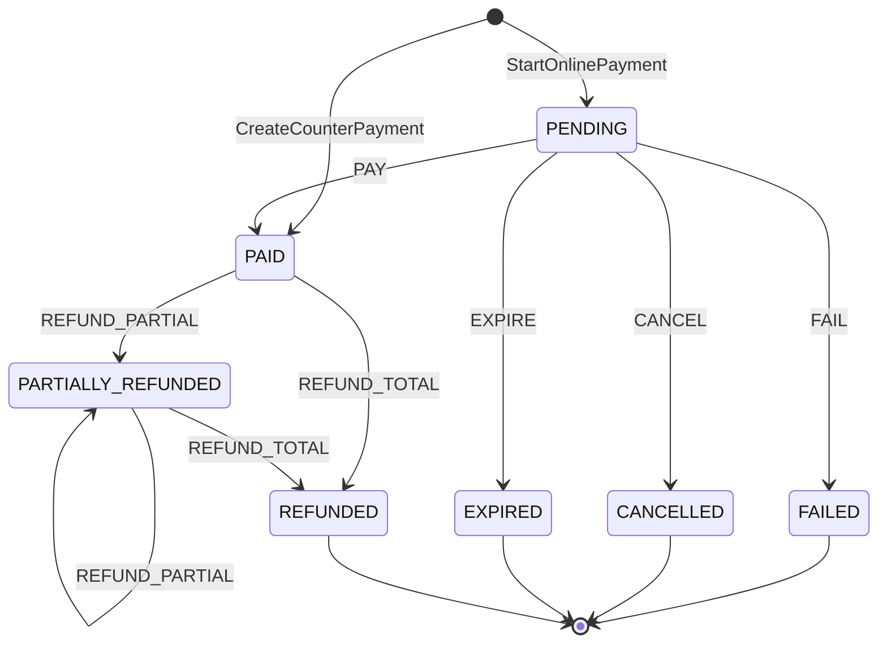

## 2. Resolver el monto (`Charge`)

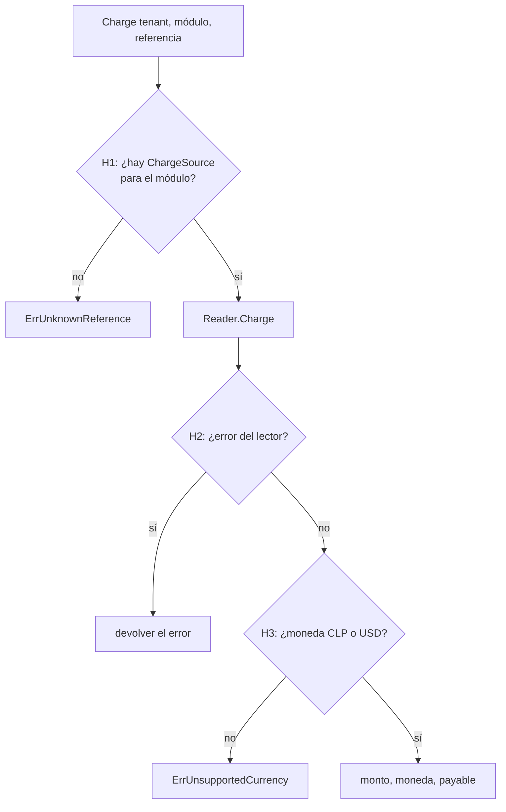

## 3. Pago de mesón (`CreateCounterPayment`)

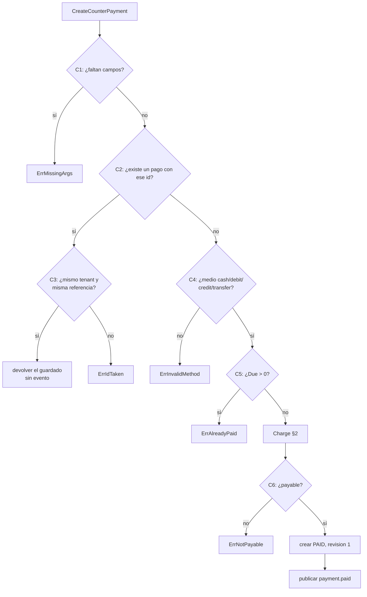

## 4. Iniciar pago online (`StartOnlinePayment`)

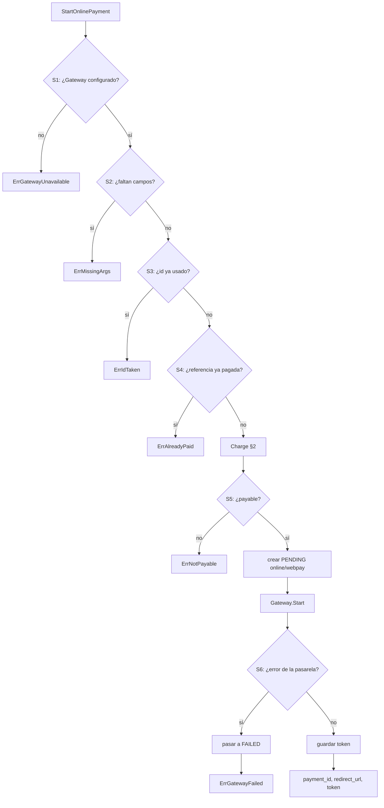

## 5. Volver de la pasarela (`CompleteOnlinePayment`)

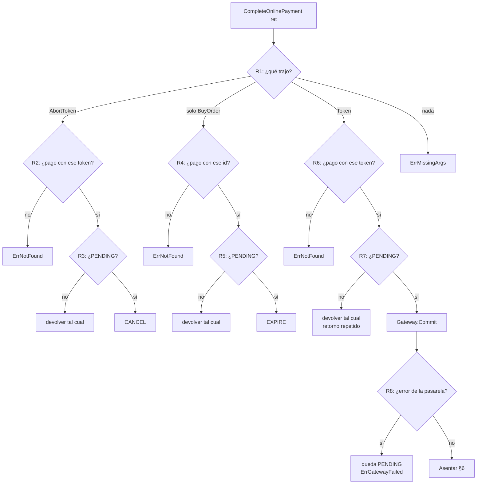

## 6. Asentar un resultado de la pasarela (lo usan §5 y §8)

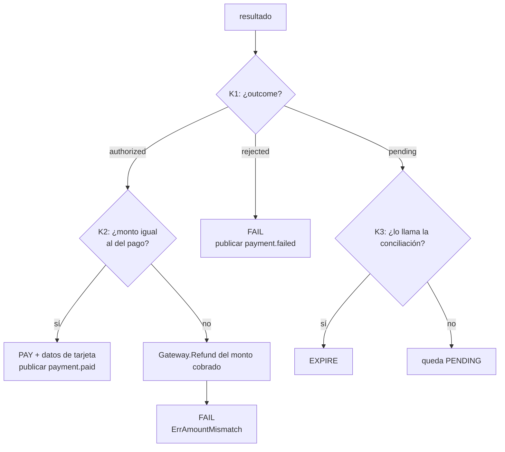

## 7. Devolver (`RefundPayment`)

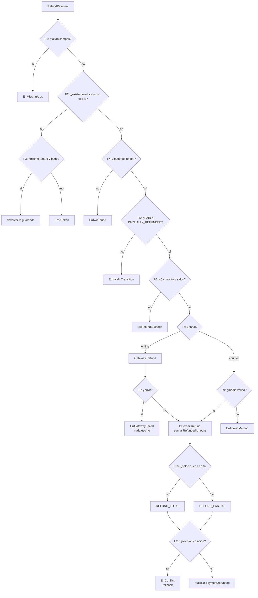

## 8. Conciliar (`ReconcilePayments`)

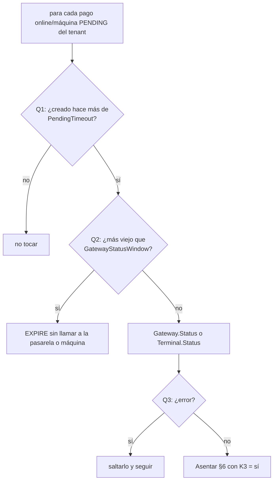

## 9. Flujo online completo (secuencia)

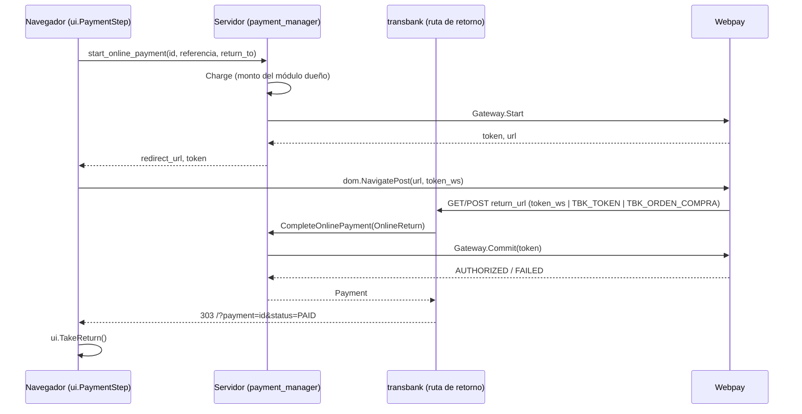

## 11. Cobro con máquina (StartTerminalPayment / RefreshTerminalPayment)

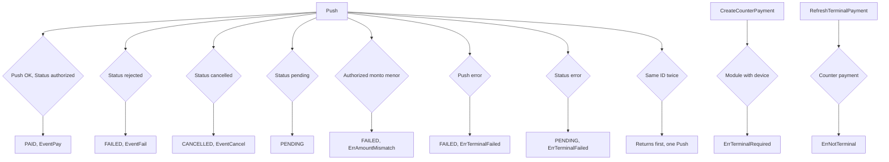

## 10. Paso de pago en pantalla (`ui.PaymentStep`)

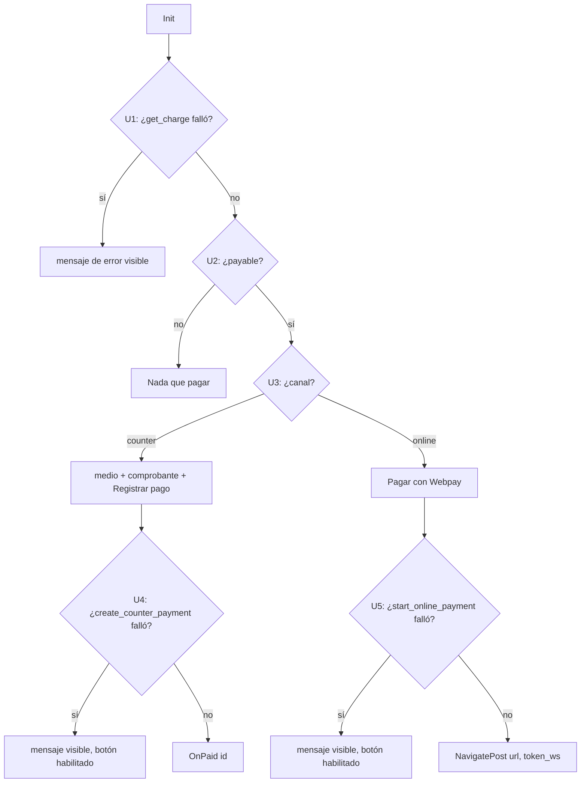
